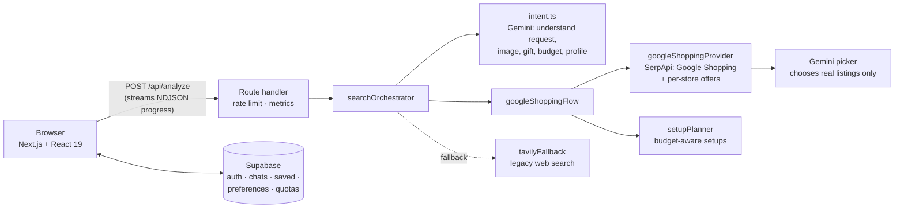

# Siftly

**A personalised shopping assistant for India.** Describe what you need ("face wash for oily skin under ₹500", "gaming setup under 1 lakh") or paste a product screenshot. Siftly finds real products on Google Shopping, picks the best ones *for you*, and compares prices, stock and offers across Indian stores.

**Live demo:** https://shiftly-alpha-rouge.vercel.app

---

## What it does

| | |
|---|---|
| 🔎 **Real products, real prices** | Live Google Shopping India listings (via SerpApi). Prices are never invented: unknown prices show "Check price". |
| 🏪 **Multi-store comparison** | For each pick: every store's price, stock, delivery and offers (e.g. "Flat ₹300 off first order"), cheapest buyable store first, trusted stores marked, suspicious prices flagged. |
| 🧠 **Understands the request** | Budgets ("under 1 lakh"), follow-ups ("make it cheaper", "in mists"), new searches vs follow-ups, gifts ("for my dad"), brand groups ("K-beauty" → COSRX, Anua, Beauty of Joseon…). |
| 📸 **Screenshot search** | Paste or drop an image; Gemini identifies the exact product, then Siftly finds it in stores. |
| 🎯 **Personalisation** | Remembers stable facts you mention ("I have oily skin", "UK 9") per category, asks one quick question when it matters, and shows *why* each product was picked. Gift searches never use your own profile. |
| 🖥️ **Complete setups** | "Gaming setup under ₹1 lakh" → one product per part, planned from real prices to use 85–100% of the budget, with alternatives. |
| 👤 **Accounts** | Supabase sign-up/sign-in; chats, pinned chats, saved products and preferences sync per user (Row Level Security). Guests keep data in the browser and it moves into their account on sign-in. |

## Architecture



**Request flow:** understand the request (Gemini, 1 call) → search Google Shopping (1+ SerpApi calls) → Gemini picks the best real listings → fetch every store's price and offers for each pick → stream the result back.

## Engineering decisions worth noting

- **The model suggests; the code decides.** LLM output is never trusted for hard rules. Examples found during testing and fixed in code:
  - A ₹1 lakh gaming setup came to ₹14,607 because the model budgeted ₹60k for an RTX PC that really costs ₹75k+, and the PC was silently dropped. Now every part is searched first, the plan is made from real prices, and code enforces the budget (swaps down when over, upgrades when under 85%).
  - The model picked a PC with integrated graphics while claiming "RTX 3050". Now code labels PCs by GPU from listing titles, rejects PC cases/cabinets, and for gaming keeps only dedicated-GPU PCs.
  - Picks pointing at listing numbers that don't exist are discarded; filler "highlights" ("Popular gifting choice") are filtered.
- **Hedged LLM requests.** I timed each Gemini model on the project's key: the fastest answered in ~1.5–2s while others took 2–20s or returned "high demand". Siftly calls the fastest first and, if it hasn't answered in a few seconds, starts a backup model in parallel; the first valid answer wins, with a hard time budget per step.
- **Data quality filters.** Overseas importers (which list inflated import prices) are filtered, http store links are upgraded to https, out-of-stock stores never become "lowest price", and prices below 55% / above 3× the median are flagged or dropped.
- **Brand catalogs.** For "Bath & Body Works fruity mist", a descriptive query returned 36/40 overseas importers; searching the brand's catalog by product type returned the official India store at the real ₹999. Official stores are matched even when titles omit the brand.
- **Abuse protection.** Per-user/per-IP hourly search limits, counted in Supabase via a `security definer` function (HMAC-hashed keys; no raw IPs stored), with an in-memory fallback.
- **Streaming UX.** The API streams NDJSON progress; the UI shows one live "thinking" line and "Searched for Ns".
- **Privacy & security.** Row Level Security on every table, profile input sanitised before it reaches prompts, guest data never leaves the browser.

## Quality: tests and evals

```bash
npm test        # 28 unit tests, no network (Gemini and SerpApi are stubbed)
npm run eval    # 6 real searches against a running server, 34 checks (costs ~25–30 SerpApi credits)
```

- **Unit tests** cover budget enforcement in the setup planner, store ordering and suspicious-price handling, brand matching for official stores, gift and memory rules, input sanitising, rate limits, and quota-exhaustion handling. Each was verified to fail when the rule it protects is broken.
- **The eval** runs real searches and checks rules such as "every price within budget", "only K-beauty brands", "gift search learns nothing", "gaming PC has a dedicated GPU", "no overseas importers", "all links https".

**Measured (local, November 2026):** single-product searches took ~9–25s and setups ~13–27s, using a median of 7 SerpApi calls per search (search + per-store comparison). In a full eval run, 30/34 checks passed; the 4 failures were traced to the SerpApi free plan running out mid-run. That led to a fix: Siftly now reports the limit honestly instead of showing a partial setup.

## Tech stack

Next.js 16 (App Router) · React 19 · TypeScript · Tailwind CSS · Google Gemini · SerpApi (Google Shopping) · Supabase (Auth + Postgres + RLS) · Vitest · Vercel

## Running locally

**1. Install**
```bash
npm install
```

**2. Configure `.env.local`** (see `.env.example`)
```env
GEMINI_API_KEY=...                 # https://aistudio.google.com/app/apikey
SERPAPI_API_KEY=...                # https://serpapi.com (Google Shopping)
NEXT_PUBLIC_SUPABASE_URL=...       # Supabase → Project Settings → API
NEXT_PUBLIC_SUPABASE_ANON_KEY=...  # the anon / publishable key (never the service_role key)
TAVILY_API_KEY=...                 # optional: legacy fallback search
```

**3. Set up the database:** run `supabase/schema.sql` in the Supabase SQL Editor (tables, Row Level Security, rate-limit function). Under Authentication → URL Configuration, set the Site URL and add `http://localhost:3000/**` to Redirect URLs.

**4. Run**
```bash
npm run dev     # http://localhost:3000
npm test
```

## Project structure

```text
src/
├── app/
│   ├── api/analyze/route.ts        # streaming search API: validation, rate limit, metrics
│   ├── page.tsx                    # chat UI, accounts, preferences, saved items
│   └── layout.tsx
├── components/                     # ChatInput, ChatMessageBubble, ProductCard, PriceComparisonModal,
│                                   # AuthModal, PreferencesModal, OnboardingModal, Sidebar, ...
└── lib/
    ├── ai/
    │   ├── gemini.ts               # hedged Gemini JSON calls (text + image)
    │   ├── intent.ts               # understand the request + personalisation rules
    │   └── constraints.ts          # budget / brand parsing
    ├── search/
    │   ├── searchOrchestrator.ts   # entry point
    │   ├── googleShoppingFlow.ts   # single products + setups on Google Shopping
    │   ├── googleShoppingProvider.ts  # SerpApi client, picking, store comparison, filters
    │   ├── setupPlanner.ts         # budget-aware setups, PC/GPU validation
    │   ├── tavilyFallback.ts       # legacy web-search fallback
    │   └── types.ts
    ├── categories.ts               # per-category preferences, expert rules, brand groups, trusted stores
    ├── store/userData.ts           # Supabase / browser storage for chats, saved items, profile
    ├── security/                   # rate limits, input sanitising, URL validation
    └── metrics.ts                  # per-search time and API usage
supabase/schema.sql                 # tables, RLS policies, rate-limit function
tests/                              # Vitest unit tests
scripts/eval-search.mjs             # real-search quality eval
```

## Known limitations

- **Speed:** 10–30s per search, mostly external API latency (each Google Shopping call takes ~5s). Vercel functions are pinned to Mumbai (`vercel.json`) to cut round trips.
- **Bank/card offers are partial:** Siftly shows the offers Google lists for each store; many bank-specific offers only appear on store pages.
- **Product knowledge in explanations** (scent notes, "good for flat feet") comes from Gemini and isn't verified against store pages.
- **Free API tiers:** the SerpApi free plan supports limited searches per month; heavy testing can exhaust it.

## License

Private project. All rights reserved.
