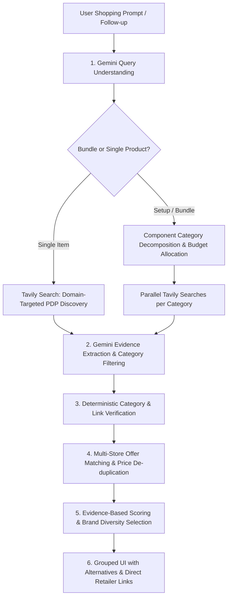

# Siftly 🛍️

> **An AI-powered intelligent shopping assistant that searches the live web, groups complete setups with component alternatives, verifies direct retailer links, and compares real prices across top stores.**

---

## 🌟 Overview

**Siftly** is an agentic shopping assistant built with Next.js 16, React 19, Google Gemini, and Tavily. Unlike typical shopping bots that hallucinate items or rely on stale static databases, Siftly executes real-time web searches against active e-commerce platforms, verifies physical product identities and categories, computes coordinated multi-component bundles, and links directly to exact product checkout pages.

---

## ✨ Key Features

- **🎯 Intelligent Intent & Context Understanding**:
  - Distinguishes between single-item searches and complex, multi-component bundles (e.g., complete gaming setups, skincare routines, home office workstations).
  - Preserves conversational context across follow-ups (*"Make it cheaper"*, *"Add a monitor"*, *"I have sensitive skin"*).
  - Makes smart initial assumptions to avoid questionnaire fatigue, asking at most one essential clarifying question when needed.

- **🖥️ Complete Setup & Bundle Intelligence**:
  - Dynamically decomposes bundle requests into essential component categories (e.g., PC, Monitor, Keyboard/Mouse combo, Headset, Ergonomic Desk/Chair).
  - Recommends up to **3 verified alternatives per component category**, allowing customers to select their preferred configuration.
  - Computes total budget against the **starter combination** (sum of 1 item per category), ensuring practical configurations never silently exceed the stated budget.

- **🛡️ Strict Category & Identity Verification**:
  - Deterministic category filtering ensures zero category cross-contamination (e.g., queries for a *toner* will never return *serums*, *cleansers*, or *moisturizers*).
  - Verifies brand, product name, model number, formulation, and variant.

- **🔗 Exact Direct Retailer Links**:
  - Deep-links directly to the verified product-detail page (PDP) on retailers like Amazon India, Nykaa, Tira Beauty, Flipkart, and DTC brand stores.
  - Avoids broken links, homepage redirects, and noisy generic store-search pages.

- **🏷️ Real Multi-Store Price Comparison**:
  - Discovers the same exact product across multiple competing merchants.
  - Displays verified prices, stock availability, and merchant badges to help buyers find the best deal.

- **📸 Visual & OCR Search**:
  - Integrated with **Tesseract.js** to extract product names and text from user-uploaded screenshots, labels, and moodboards.

- **💾 Saved Looks & History Drawer**:
  - Bookmark favorite products and complete setup looks locally with real-time price tracking.

---

## 🏗️ Architecture & Search Pipeline

Siftly uses a dual-engine architecture combining Google Gemini's reasoning with Tavily's real-time web crawling:



1. **Query & Intent Parsing**: Gemini 2.5 parses user constraints, budget limits, category intent, and conversational history.
2. **Live Web Crawling**: Tavily queries targeted retail domains (Amazon India, Nykaa, Tira, Flipkart, etc.) without obstructive query syntax.
3. **Evidence Extraction**: Product titles, brands, prices, images, and destination URLs are extracted strictly from grounded search snippets.
4. **Category & Identity Guardrails**: Algorithmic rules verify that candidate titles match the exact target category (e.g., discarding AHA BHA serum candidates when searching for toner).
5. **Multi-Store Discovery**: The pipeline searches alternative stores for identical product titles and merges them into comparison offers.
6. **Grouped Presentation**: Setups are organized into clear component sub-grids showing alternatives, while single products render in a clean 3-recommendation layout.

---

## 🛠️ Tech Stack

| Layer | Technologies |
| :--- | :--- |
| **Framework** | [Next.js 16 (App Router, Turbopack)](https://nextjs.org/) |
| **Frontend UI** | [React 19](https://react.dev/), [TypeScript](https://www.typescriptlang.org/), [Tailwind CSS](https://tailwindcss.com/) |
| **Icons & Animation** | [Lucide React](https://lucide.dev/), [Framer Motion](https://www.framer.com/motion/), [Canvas Confetti](https://www.npmjs.com/package/canvas-confetti) |
| **Vision & OCR** | [Tesseract.js](https://tesseract.projectnaptha.com/) |
| **AI & LLM** | [Google Gemini 2.5 API](https://ai.google.dev/) (`gemini-2.5-flash` / `gemini-2.5-flash-lite`) |
| **Web Search Engine** | [Tavily Search API](https://tavily.com/) |

---

## 📁 Project Structure

```text
Siftly/
├── public/                       # Static public assets & brand icons
├── src/
│   ├── app/
│   │   ├── api/
│   │   │   └── analyze/
│   │   │       └── route.ts      # Main POST API endpoint for chat & search analysis
│   │   ├── globals.css           # Global Tailwind styling and animations
│   │   ├── layout.tsx            # Root application layout & metadata
│   │   └── page.tsx              # Main interactive shopping dashboard
│   ├── components/
│   │   ├── shopping/
│   │   │   ├── DetectedLookBar.tsx       # Active bundle / entity status bar
│   │   │   ├── PriceComparisonModal.tsx  # Multi-merchant comparison modal
│   │   │   ├── ProductCard.tsx           # Product card with price, rating, & retailer links
│   │   │   └── ShoppingView.tsx          # Shopping results grid wrapper
│   │   ├── recipe/                       # Recipe & ingredient breakdown components
│   │   ├── AnalysisProgressIndicator.tsx # Search status steps indicator
│   │   ├── AuthModal.tsx                 # Optional user authentication modal
│   │   ├── ChatInput.tsx                 # Search & prompt text input bar
│   │   ├── ChatMessageBubble.tsx         # Chat feed & grouped bundle component display
│   │   ├── Header.tsx                    # Top navigation, logo, and active look counters
│   │   ├── SavedLooksDrawer.tsx          # Saved items and wishlist slide-out drawer
│   │   ├── Sidebar.tsx                   # Filter sidebar, budget sliders, & category selectors
│   │   └── UnifiedInput.tsx              # Multi-modal input (text + image upload + OCR)
│   ├── lib/
│   │   ├── ai/
│   │   │   └── pipeline.ts               # Core shopping pipeline orchestrator
│   │   ├── search/
│   │   │   ├── geminiShoppingService.ts  # Gemini prompt formatting & response parsing
│   │   │   ├── liveRetailerSearch.ts     # Fallback query builders
│   │   │   └── tavilyShoppingPipeline.ts # Live Tavily crawler, category filters & bundle logic
│   │   ├── security/
│   │   │   └── urlValidator.ts           # Safe retailer URL parsing & affiliate link validation
│   │   ├── vision/
│   │   │   ├── dynamicProductResolver.ts # Vision fallback resolver
│   │   │   ├── ocrExtractor.ts           # Tesseract OCR processing
│   │   │   └── smartImageAnalyzer.ts     # Vision analysis pipeline
│   │   └── constants.ts                  # Category definitions, retailer list, and fallbacks
│   └── types/
│       └── index.ts                      # Shared TypeScript data models
├── .env.example                  # Environment variable template with placeholders
├── .gitignore                    # Git exclusions protecting secrets and build files
├── next.config.mjs               # Next.js configuration
├── package.json                  # Project dependencies & scripts
├── tailwind.config.ts            # Tailwind CSS styling configuration
└── tsconfig.json                 # TypeScript compiler options
```

---

## 🚀 Getting Started

### Prerequisites

- **Node.js**: `v18.18.0` or higher (Node 20+ recommended)
- **npm** or **yarn** / **pnpm**
- **Google Gemini API Key**: [Get one free from Google AI Studio](https://aistudio.google.com/app/apikey)
- **Tavily Search API Key**: [Get one from Tavily](https://tavily.com/)

### Installation

1. **Clone the repository**:
   ```bash
   git clone https://github.com/<your-username>/siftly.git
   cd siftly
   ```

2. **Install dependencies**:
   ```bash
   npm install
   ```

3. **Configure environment variables**:
   Copy `.env.example` to `.env.local`:
   ```bash
   cp .env.example .env.local
   ```
   Open `.env.local` and add your API keys:
   ```env
   # Google Gemini API Key
   GEMINI_API_KEY=AIzaSy...

   # Tavily Search API Key
   TAVILY_API_KEY=tvly-...

   # App URL (optional, defaults to http://localhost:3000)
   NEXT_PUBLIC_APP_URL=http://localhost:3000
   ```

> [!CAUTION]
> Never commit your `.env.local` or push actual API keys to GitHub. The included `.gitignore` protects these automatically.

---

## 🏃 Running the Application

### Development Server

Run the development server with Turbopack:
```bash
npm run dev
```
Open [http://localhost:3000](http://localhost:3000) in your browser.

### Production Build

Create an optimized production build:
```bash
npm run build
```

Start the production server:
```bash
npm run start
```

### Linting

Check for linting and code style issues:
```bash
npm run lint
```

---

## 🔍 Example Prompts to Try

- **Individual Item with Budget**:
  - *"Recommend a salicylic acid cleanser under ₹600"*
  - *"Find 3 mechanical keyboards with red switches under ₹3,000"*
- **Complete Setup & Bundles**:
  - *"I need a complete gaming setup under ₹1,00,000"*
  - *"Minimalist home office setup under ₹40,000 with a desk and chair"*
  - *"Basic skincare routine for oily acne-prone skin under ₹2,000"*
- **Follow-up Interactions**:
  - *"Make it cheaper"*
  - *"Add a 24-inch monitor"*
  - *"Show me more options for the keyboard"*

---

## ⚠️ Known Limitations & Notes

1. **Merchant Cloudflare / Bot Protection**:
   - Some regional merchants (e.g., quick-commerce apps like Blinkit/Zepto) block programmatic DOM scraping. Siftly leverages Tavily's search indexes and domain parsing to verify prices and links without scraping blocked pages directly.
2. **Catalog Turnover**:
   - In rare cases where a retailer abruptly discontinues a SKU or rotates the product URL, Siftly falls back to a verified, retailer-scoped search page rather than serving a broken 404 link.

---

## 📄 License

This project is private and proprietary. All rights reserved.
